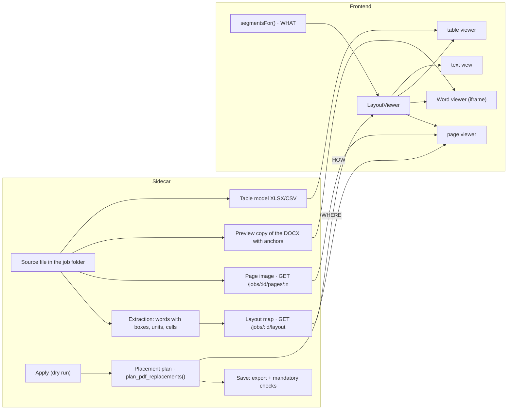

# Architecture

How the parts of unname fit together. The behavior they have to deliver is in
[spec.md](spec.md); how detection works is in [detection.md](detection.md).

## The three processes

```text
┌──────────────────────────── unname.app (Tauri 2) ─────────────────────────────┐
│  WebView: SvelteKit 3 UI (app/src)        Shell: Rust (app/src-tauri/src)     │
│   - no file system access                  - file inputs, dialogs, clipboard  │
│   - no token, no port                      - saving into the target folder    │
│   - calls  unname-api://localhost  ──────► - unname-api scheme: forwards       │
│                                              requests, adds the token         │
│                                            - starts and watches the sidecar   │
│                                            - model download (or XPC service)  │
└───────────────────────────────────────────────┬───────────────────────────────┘
                                                │ Unix socket (macOS) /
                                                │ 127.0.0.1 + token (Windows)
                                   ┌────────────▼─────────────┐
                                   │ Sidecar: Python, FastAPI │  helpers (own processes):
                                   │ Presidio, ONNX Runtime   │  - unname-vision-ocr (macOS)
                                   │                          │  - Tesseract (Windows)
                                   └──────────────────────────┘  - unname-office-engine (optional)
```

| Part | Directory | Responsibility |
|---|---|---|
| UI | [app/src](../app/src) | Screens, state, i18n. Never touches files or the network. |
| Shell | [app/src-tauri/src](../app/src-tauri/src) | Everything the OS must do: file access, dialogs, clipboard, saving, process supervision, the only network access (model download). Derives `can_upload` and `can_export`; the UI only reads them. |
| Sidecar | [sidecar/src/presidio_sidecar](../sidecar/src/presidio_sidecar) | Extraction, detection, masking, vault, history, drafts, export. The HTTP API is described in [app/src/lib/sidecar/api.schema.json](../app/src/lib/sidecar/api.schema.json); the TypeScript client is generated from it (`node scripts/api-types.mjs`). |
| Helpers | [vision-ocr](../vision-ocr), [download-xpc](../download-xpc), [office-engine](../office-engine) | Small programs with a narrow interface and no network rights of their own (except the download service). |

### Transport

- **macOS (and Linux):** the sidecar listens on a Unix domain socket (`--uds`)
  in a private folder that is new on every start, inside the app container.
  The app carries no `network.server` entitlement.
- **Windows:** TCP on `127.0.0.1` with a random port.
- **Both:** the sidecar prints a ready message on stdout; the shell accepts only
  the socket path it specified. Every endpoint requires a bearer token that is
  new on every start. The WebView never sees it: it calls the `unname-api`
  scheme (`unname-api://localhost`, `http://unname-api.localhost` on Windows),
  and `app/src-tauri/src/api_scheme.rs` forwards method, path, query, body and
  a few headers.
- The CSP allows only `'self'` and the `unname-api` scheme.

### Fail-closed

The shell is the single place that decides whether dropping, saving and
copying are allowed (`can_upload`, `can_export`). A watchdog notices both a
dead process and a hung one. If the sidecar fails during a job, the file is
marked failed and no partial result is saved. See [spec.md](spec.md#fail-closed).

## Sidecar modules

| Area | Modules |
|---|---|
| API | `app.py`, `routers/`, `api_models.py`, `api_schema.py`, `api_common.py` (offsets are UTF-16 compatible with the WebView) |
| Extraction | `extraction/` (PDF, DOCX, XLSX, CSV, text, images), `extraction/ocr.py` (Tesseract), `extraction/ocr_vision.py` (Apple Vision helper), `docx_preview.py`, `grid_model.py` |
| Detection | `detection/` (pipeline, GLiNER ONNX, spaCy, suspicion, second opinion), `deterministic_recognizers.py`, `analysis.py`, `base_profile.py`, `profiles.py`, `templates.py`, `vocabulary.py`, `registry.py` (name lists) |
| Masking | `masking.py`, `catalog.py`, `processing.py`, `assessments.py`, `residual_risk.py` |
| Vault | `vault.py` (HMAC secret, translation table), `vault_backup.py`, `restore.py`, `restored_files.py` |
| Entries and drafts | `entries.py` (history, encrypted), `drafts.py` (encrypted working state), `draft_jobs.py`, `titles.py`, `workflow.py`, `document_workflow.py`, `jobs.py` |
| Layout | `layout.py`, `rendering.py`, `placement.py`, `paged_docx.py`, `office_engine.py` |
| Saving | `saving.py`, `exporting.py`, `audit.py` |
| Runtime | `config.py`, `runtime.py`, `workers.py`, `hardware.py`, `qos.py`, `security.py`, `handshake.py`, `diagnostics.py`, `resources.py` |

## Data at rest

Everything is local, and everything personal is encrypted.

| Data | Where | Protection |
|---|---|---|
| History (entries, decisions, titles, short references) | `entries.enc` in the app state folder | encrypted; content-free |
| Drafts: original, extraction and detection per file | `drafts.noindex/<entry>/<file>/` in the app data folder | AES-256-GCM in 1 MiB blocks, one key per entry, wrapped with a master key; excluded from Spotlight and backup |
| Translation table and secret | vault in the sidecar state | encrypted SQLite; the secret has `0600` permissions; exported only as a password-protected backup (scrypt + AES-GCM) |
| Name lists, custom terms and patterns | registry in the sidecar state | encrypted |
| Settings | settings store | no personal data |
| Audit | SQLite | metadata only: no original values, no excerpts |
| Job working folders | `job-temp.noindex` in the caches directory | cache only; may disappear at any time |

### Vault: determinism without storage

A code is `HMAC-SHA256(secret, type + normalized value)`, truncated, so the
same name always gives the same code without any stored table. The table is
only needed to go back, and it is written only when the user saves or copies
("saving is the commit"). One table serves all entries, which is why
restoring recognizes codes from any earlier entry. Details: [spec.md](spec.md#7-masking-categories-and-the-way-back).

### Drafts

From the moment a file is read in, its entry is self-supporting: the original
is encrypted and stored before the sidecar answers `202`, and extraction and
detection are stored when they finish. The disk is the truth, memory is a cache:

- A job is loaded from the draft on first access (`JobManager.get` calls a
  loader). The job time-to-live is now an idle time in memory; nothing is deleted
  when it passes. Loaded jobs are capped (64 files, 768 MiB, least recently used).
- Reopening does not recompute: stored extraction and detection are shown as
  they were. A file is detected again only on request ("Detect again").
- Derived data (page images, layout maps, grids, apply results) is never stored
  but regenerated; the dry run is deterministic.
- Artifacts are written atomically (temporary file, fsync, rename); the manifest
  comes last and is the commit point. Files without a readable artifact get the
  state `unavailable`, and the way out is "Choose original".
- **Deleting** has one path for "Delete entry", "Clear history" and retention:
  tombstone, then the entry and its key leave `entries.enc` in one atomic write
  (crypto-shredding), then jobs, memory and files are freed. The sidecar sweeps
  folders without an entry at start and hourly.

Measurements are in [acceptance/drafts.json](../acceptance/drafts.json).

### Entries and the history views

One rule maps every entry to exactly one state (processing, to review, error,
changed since saving, saved, copied), and the open/completed/all views are
projections of it. The short reference is random, unique among the entries of
the device and immutable; routes and the API keep using the entry ID. The
overview searches only title, reference, format and date, in memory
(`app/src/lib/history`).

## Layout viewers

Review shows documents the way they will be saved. Three questions are answered
by three sources:

| Question | Source |
|---|---|
| **What** is at a spot (code, placeholder, question, kept …)? | `segmentsFor()` in the UI, from findings, review state and apply result |
| **Where** is the spot in the rendered document? | the **layout map**: word boxes (fixed pages), anchors per text unit (Word), cells (Excel, CSV); `GET /jobs/{id}/layout` |
| **How** does the export draw the replacement (area, baseline, size, font)? | the **placement plan** in the apply response (`placement.py`); fixed pages only, Word and Excel replace in the text |



| Format | View | Rendered by | Result in the view | Output on save |
|---|---|---|---|---|
| PDF with text | pages | sidecar, MuPDF | overlay from the placement plan | PDF, truly redacted |
| PDF scanned or mixed | pages | sidecar, MuPDF | overlay | PDF painted over, code as text, invisible OCR layer |
| PNG/JPG | one page | sidecar, Pillow (EXIF orientation as in OCR) | overlay | image with the replacement drawn in |
| DOCX | flow with pages | WebView, docx-preview, from a cleaned preview copy | replacement in the DOM | DOCX, replacement in the run |
| DOCX, page-faithful (optional) | pages | `unname-office-engine` | page image with located markers | DOCX |
| XLSX | grid | WebView, own grid from the table model | replacement in the cell | XLSX |
| CSV | grid | the same grid without styles | replacement in the cell | CSV |
| TXT, MD, text mode | text | `SegmentText` | as before | as before |

Rules that keep the view honest:

- The preview copy of a DOCX is built from the same file the export writes, so
  every replacement sits in the same unit and run in both. A unit that cannot be
  mapped is shown simplified and named.
- For PDFs the result view must match the rendering of the saved file (acceptance
  criterion A-26).
- Scans stay scans: the replacement is drawn over the pixels, an invisible OCR
  text layer is added, and OCR must read every code back before the export is
  accepted (A-29).

## Native pieces on macOS

| Piece | Why |
|---|---|
| `unname-vision-ocr` | Text recognition with Apple Vision, one process per page, bytes in and JSON out. See [vision-ocr/README.md](../vision-ocr/README.md). |
| `org.unname.desktop.download` | XPC service with its own sandbox and the only network right in the package. Checks HTTPS, host and redirects; the shell checks size and SHA-256. See [download-xpc/README.md](../download-xpc/README.md). |
| Sandbox entitlements | The app has `network.client` (WKWebView needs it) but no `network.server`; helpers inherit the sandbox. |
| Name detection | GLiNER on ONNX Runtime with its own runner (`detection/gliner_onnx.py`), CPU only, no PyTorch at runtime. |
| Frozen sidecar | A onedir build; in a release only the bundled binary and `assets/` from the signed package count. |

## Frontend structure

| Directory | Contents |
|---|---|
| `app/src/routes` | `(app)` routes (start, history, `entry/[id]/review`, `entry/[id]/restore`, …), `setup`, `(dev)/components` (developer pages) |
| `app/src/lib/features` | screens: `start`, `review`, `saved`, `restore`, `history`, `settings`, `models`, `shell` |
| `app/src/lib/ui` | own components on Bits UI |
| `app/src/lib/state` | Svelte 5 rune state per concern |
| `app/src/lib/sidecar` | the API client, generated types, the gate state |
| `app/src/lib/i18n` | the typed dictionary: `de.ts` is the reference, `en.ts` must be complete |
| `app/src/lib/styles`, `app/src/lib/theme` | design tokens (`tokens.css`) and contrast checks |

Colors live only in `tokens.css`; a build guard rejects palette classes,
`dark:` in components and inline colors. The UI colors by state, not by entity
type.
